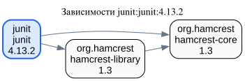
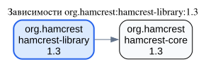
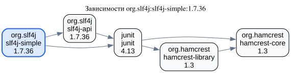

# Визуализатор зависимостей пакетов

Практическая работа №2 по дисциплине «Конфигурационное управление».
Вариант №22, все пять этапов выполнены. Язык реализации — Go.

## Общее описание

Консольное приложение строит граф зависимостей Java-пакета (Maven) или пакета
из тестового текстового репозитория. Настройки читаются из INI-файла.
Граф строится **рекурсивным DFS** с учётом транзитивных зависимостей.
Используется только стандартная библиотека Go, без запуска Maven и сторонних
библиотек получения зависимостей.

Возможности третьего этапа:

- обход всех доступных из корня пакетов в глубину;
- исключение пакетов по подстроке до загрузки их зависимостей;
- сохранение рёбер циклов без бесконечной рекурсии;
- однократный обход общих зависимостей с сохранением всех входящих рёбер;
- работа с тестовым репозиторием без доступа к интернету;
- вывод списка смежности в порядке DFS, обратных рёбер циклов и исключённых пакетов;
- общий кэш POM на время анализа Maven, включая родителей и BOM.

Первый этап добавил INI и проверки параметров. Второй — загрузку и разбор POM,
подстановку свойств, наследование, dependencyManagement и импорт BOM.
На четвёртом этапе добавлен режим `-reverse <пакет>` для обратных зависимостей.
Пятый этап добавил описание Graphviz (DOT) в stdout и примеры диаграмм SVG.
Прежний список смежности доступен с `-format text`. Отладочный список параметров и отдельный список прямых
зависимостей требовались только на первом и втором этапах соответственно.

Ошибки выводятся в stderr с кодом возврата 1. При ошибке построения частичный граф
не печатается. Успешный запуск, в том числе при найденном цикле, и справка имеют код 0.

## Быстрый запуск

Требуется Go 1.26.4 или новее. Команды выполняются из корня репозитория.

```sh
# Обратные зависимости D без интернета:
go run ./src -config examples/stage4/diamond.ini -reverse D
# Все случаи четвёртого этапа:
make demo-reverse
# Три диаграммы пятого этапа (нужны интернет и Graphviz):
make demo
# Обычный граф третьего этапа:
go run ./src -config examples/stage3/cycle.ini -format text
# Реальный Maven: небольшой граф JUnit, нужен интернет
./run.sh
# Реальный граф с фильтрацией:
./run.sh -config examples/maven-filter.ini
# Сборка:
make build
./bin/depgraph -config examples/test.ini
# Справка:
go run ./src -help
```

Флаг `-config <путь>` выбирает INI-файл; по умолчанию используется `config.ini`
в текущем рабочем каталоге. Четыре настройки приложения задаются в INI.
Дополнительный флаг `-reverse <пакет>` выбирает операцию четвёртого этапа и её цель.
Без `-reverse` по умолчанию выводится DOT; `-format text` возвращает вывод третьего этапа.
В режиме `-reverse` формат по умолчанию — текст; явный `-format dot` несовместим с ним.
Пустое имя после флага,
неизвестный или исключённый фильтром пакет вызывают ошибку.
`run.sh` и демонстрационные скрипты переходят в корень проекта, поэтому переданный
им относительный путь к INI считается от корня проекта.

## Конфигурация

Все четыре ключа обязательны и находятся в секции `[settings]`.

| Параметр | Значение |
| --- | --- |
| `package` | Корневой пакет. В Maven — координаты `groupId:artifactId:version`; в тестовом режиме — заглавные латинские буквы, например `A` или `ROOT`. |
| `repository` | Абсолютный HTTP(S)-адрес Maven-репозитория или путь к тестовому файлу. Относительный путь к файлу считается от каталога INI. |
| `test_mode` | `true` — тестовый файл, `false` — Maven. Другие значения запрещены. |
| `filter` | Подстрока для исключения пакетов. Пустое значение отключает фильтрацию. |

Фильтр чувствителен к регистру и применяется ко **всему имени вершины**: в Maven это
`groupId:artifactId:version`, в тестовом файле — имя из букв. Если имя совпало,
вершина и рёбра к ней исключаются, её зависимости не запрашиваются. Ветвь ниже неё
тоже не обходится, но те же пакеты могут попасть в граф по другому доступному пути.
Если совпал сам корень, получается пустой граф с пояснением. Список исключений
содержит только пакеты, встреченные во время обхода.

Пример тестовой конфигурации:

```ini
[settings]
package = A
repository = cycle.txt
test_mode = true
filter =
```

Конфигурация по умолчанию теперь использует небольшой реальный граф JUnit:

```ini
[settings]
package = junit:junit:4.13.2
repository = https://repo.maven.apache.org/maven2
test_mode = false
filter =
```

Поддерживается одна секция `[settings]`, пары `ключ = значение`, пустые строки
и отдельные строки-комментарии с `#` или `;`. Ключи чувствительны к регистру.
Пробелы по краям значений удаляются; кавычки не нужны и не снимаются.
Символы `#`, `;` и `=` внутри значений сохраняются. Комментарии после значения
не поддерживаются. Поддерживаются UTF-8 BOM и окончания строк LF/CRLF.
Повторы и неизвестные ключи/секции, неверный UTF-8 и управляющие символы запрещены.
URL задаётся без логина, пароля, параметров запроса и фрагмента.

## Формат тестового репозитория

```text
# Ромб: общая зависимость D
A: B C
B: D
C: D
D:
```

Слева от `:` находится имя пакета, справа — его прямые зависимости через пробелы.
Порядок справа определяет порядок DFS. Для листа обязательно отдельное объявление
вида `D:`. Имена состоят только из заглавных латинских букв `[A-Z]+`.

Пустые строки, полнострочные комментарии `#` и `;`, BOM и CRLF поддерживаются.
Повторные рёбра в одной строке объединяются. Повторные объявления пакета, неверные
имена и ссылки на необъявленные пакеты считаются ошибкой. Проверяется весь файл,
включая недостижимые пакеты; в итоговый граф попадает только доступная из корня часть.
Циклы и самоссылки допустимы. Неизвестный корень вызывает ошибку при его загрузке.

## DFS и циклы

Перед спуском вершина отмечается как находящаяся в текущем стеке рекурсии.
После обработки её зависимостей она отмечается завершённой.

- Новая вершина обходится рекурсивным вызовом `visit`.
- Ребро к вершине в текущем стеке отмечает цикл; само ребро сохраняется.
- Ребро к завершённой вершине тоже сохраняется, но повторного обхода не происходит.

Поэтому общая зависимость в ромбе не считается циклом. Раздел «Циклы» показывает
обратные рёбра DFS, а не перечисление всех возможных циклических путей.

Для `examples/stage3/cycle.ini` с `-format text`:

```text
Граф зависимостей A (DFS):
A -> B
B -> C
C -> A, D
D -> (нет зависимостей)
Циклы (обратные рёбра DFS):
C -> A
```

Для `examples/stage3/shared-filter.ini` с фильтром `B` и `-format text`:

```text
Граф зависимостей A (DFS):
A -> C
C -> D
D -> (нет зависимостей)
Циклы: нет
Исключены фильтром: B
```

Зависимость `D` остаётся, поскольку до неё можно добраться через `C`.

## Демонстрация третьего этапа

```sh
./scripts/run_stage3.sh
# То же самое:
make demo-graph
```

Демонстрация полностью работает без интернета.

| Пример в `examples/stage3` | Что проверяется |
| --- | --- |
| `chain.ini` | Транзитивная цепочка A → B → C → D. |
| `diamond.ini` | Общая зависимость D и недостижимая часть X → Y. |
| `cycle.ini` | Цикл из трёх пакетов и выход из него к D. |
| `self-cycle.ini` | Самоссылка A → A и обычная зависимость B. |
| `filter.ini` | Исключение BX и всей ветви под ним по подстроке B. |
| `shared-filter.ini` | Сохранение альтернативного пути к D после исключения B. |
| `root-filter.ini` | Исключение корня и пустой граф. |
| `isolated.ini` | Корень без зависимостей. |
| `errors/*.ini` | Синтаксис, неизвестная ссылка, повторное объявление, неизвестный корень, неверное имя, пустой файл. |

Скрипт показывает все успешные случаи и проверяет код 1 у ошибочных запусков.

Для демонстрации через Maven Central:

```sh
make demo-maven
# Или:
./scripts/run_maven_graph.sh
```

Вывод без фильтра:

```text
Граф зависимостей junit:junit:4.13.2 (DFS):
junit:junit:4.13.2 -> org.hamcrest:hamcrest-core:1.3, org.hamcrest:hamcrest-library:1.3
org.hamcrest:hamcrest-core:1.3 -> (нет зависимостей)
org.hamcrest:hamcrest-library:1.3 -> org.hamcrest:hamcrest-core:1.3
Циклы: нет
```

## Обратные зависимости — этап 4

```sh
./run.sh -config examples/stage4/diamond.ini -reverse D
# Демонстрация всех случаев без интернета:
./scripts/run_stage4.sh
# Или:
make demo-reverse
```

Обратные зависимости пакета — пакеты, которые от него зависят. Для цепочки
`A -> B -> D` прямой обратной зависимостью D является B, а транзитивной — A.
Программа отдельно показывает прямой список и полный список в порядке DFS.
Полный список включает прямые зависимости и не содержит повторов.

Алгоритм меняет направление всех рёбер выбранной области поиска и вызывает
**тот же `graph.Build` с рекурсивным DFS**, который реализован на третьем этапе.
Циклы обрабатываются теми же отметками посещения. Сам целевой пакет исключается
из обоих списков даже при цикле или самоссылке. Исходный граф не изменяется.
Для воспроизводимого результата входящие рёбра упорядочиваются по имени исходного пакета.

Область поиска всегда указана в выводе:

- **Тестовый режим:** весь файл репозитория, включая пакеты вне ветви `package`.
  Поле `package` остаётся обязательным параметром конфигурации, но цель поиска
  определяется `-reverse`. Например, если `A -> D` и отдельно `X -> D`,
  обратный поиск для D найдёт и A, и X.
- **Maven:** граф, загруженный от `package` из INI с учётом фильтра третьего этапа.
  Пакеты, не попавшие в этот граф, не перечисляются. Это обратные зависимости
  в выбранном графе, а не поиск по всему Maven Central: POM не предоставляет
  индекс всех внешних пакетов, которые на него ссылаются.

Фильтр исключает совпавшие пакеты и пути через них. Если существует другой путь
к цели, пакет остаётся в результате. В тестовом режиме фильтр применяется во время
обратного DFS; в Maven он применяется при загрузке исходного графа и обратном обходе.
Саму цель, совпадающую с фильтром, анализировать нельзя — выводится ошибка.

Пример для ромба `A -> B, C`, `B -> D`, `C -> D`:

```text
Обратные зависимости D:
Область поиска: весь тестовый репозиторий
Прямые: B, C
Все (прямые и транзитивные, DFS): B, A, C
```

В этом же примере A присутствует один раз, хотя до D ведут два пути.
Отсутствие обратных зависимостей выводится как `(нет)` и не является ошибкой.

| Пример в `examples/stage4` | Цель `-reverse` | Что демонстрирует |
| --- | --- | --- |
| `chain.ini` | `D` | Прямую C и транзитивные B, A. |
| `diamond.ini` | `D` | Два прямых зависимых пакета и отсутствие повторов A. |
| `other-branch.ini` | `D` | Пакет X вне ветви исходного package. |
| `cycle.ini` | `A` | Корректное завершение на цикле A → B → C → A. |
| `self-cycle.ini` | `A` | Сам пакет не попадает в список при A → A. |
| `no-dependents.ini` | `A` | Отсутствие зависимых пакетов. |
| `filter.ini` | `D` | Исключение BX и пути A → BX → D. |
| `alternate-path.ini` | `D` | Сохранение A благодаря альтернативному пути через C. |
| `filtered-target.ini` | `D` | Ошибку при совпадении самой цели с фильтром. |

Скрипт дополнительно проверяет ошибки неизвестного и пустого имени пакета.
Все демонстрации четвёртого этапа работают без интернета.

Пример для реального Maven-графа, требующий доступа к репозиторию:

```sh
./run.sh -config config.ini -reverse org.hamcrest:hamcrest-core:1.3
```

В графе JUnit из конфигурации по умолчанию обратными зависимостями hamcrest-core
являются `junit:junit:4.13.2` и `org.hamcrest:hamcrest-library:1.3`.

## Визуализация — этап 5

По умолчанию stdout содержит только описание `digraph` на языке Graphviz:
его можно показать в терминале или перенаправить в файл без удаления служебных строк.
Для получения DOT достаточно Go. Graphviz нужен только для преобразования в картинку;
Maven нужен отдельно для эталонного сравнения.

```sh
# На macOS инструменты для диаграмм и сравнения можно установить так:
brew install graphviz maven
# Описание графа на экране:
./run.sh -config examples/stage5/junit.ini
# Сохранение и отрисовка:
make build
./bin/depgraph -config examples/stage5/junit.ini > bin/junit.dot
dot -Tsvg bin/junit.dot -o bin/junit.svg
# Три реальных пакета, DOT в терминале и файлы DOT/SVG в bin/stage5:
make demo
# Независимое сравнение со стандартным dependency:tree:
make compare
```

Синий прямоугольник обозначает корень, стрелка `A -> B` — зависимость A от B.
Красным выделяются обратные рёбра DFS, обнаруженные при обработке циклов.
Общие зависимости и все рёбра сохраняются; листья и одиночный корень объявляются явно.
При исключении корня выводится корректный пустой граф с пояснением в заголовке.
Кавычки, обратные косые черты и переносы строк экранируются.

Ниже сохранены результаты для трёх различных пакетов без фильтрации, полученные
из Maven Central. Исходные DOT лежат рядом с SVG в `examples/stage5/graphs`.

### JUnit 4.13.2



### Hamcrest Library 1.3



### SLF4J Simple 1.7.36



[Сравнение с Maven: команды, исходные деревья и объяснение расхождений](examples/stage5/COMPARISON.md).
`make compare` использует исходный POM каждого пакета как проект Maven.
Это отдельный проверочный скрипт: приложение на Go получает зависимости самостоятельно.
При первом запуске Maven скачивает плагин и зависимости; кэш и временные POM
сохраняются в игнорируемом каталоге `bin/stage5/comparison`.

Форматы описаны в [документации DOT](https://graphviz.org/doc/info/lang.html)
и [документации dependency:tree](https://maven.apache.org/plugins/maven-dependency-plugin/tree-mojo.html).

## Как обрабатывается Maven

POM загружается по стандартному пути: точки `groupId` заменяются `/`, затем
добавляется `artifactId/version/artifactId-version.pom`. Родители и импортированные
BOM берутся из того же репозитория. Поддерживаются свойства POM, переопределение
свойств ребёнком, наследование зависимостей и получение версий из dependencyManagement.
Явная версия имеет приоритет над управлением версиями; обычные записи управления —
над импортом, при конфликте импортов используется первый BOM.

На каждой вершине используется сборщик прямых зависимостей второго этапа.
DFS рекурсивно обходит полученные координаты. Разные версии — разные вершины;
разные type/classifier с одинаковыми координатами объединяются в одну вершину,
поскольку используют один POM. Порядок объявления сохраняется.

Это граф объявленных зависимостей базовых POM: обходятся все scope, включая `test`,
`provided` и `optional`. Правила Maven о передаче scope, optional и exclusions,
разрешение конфликтующих версий и активация профилей не моделируются.
Поэтому такой граф может быть шире дерева зависимостей конкретной сборки Maven.
Не используются settings.xml, переменные окружения, локальный Maven-кэш,
дополнительные репозитории из POM и relocation.

Для обхода нужны конкретные release-версии. При встрече диапазона версий или
SNAPSHOT, требующих выбора версии из maven-metadata.xml, выводится ошибка.
Неизвестные свойства, повреждённый XML, циклы родителей/BOM и HTTP-ошибки тоже
завершают анализ с пояснением. Поддерживаются XML в UTF-8 и ISO-8859-1.
HTTP 429 означает ограничение запросов сервером; автоматических повторов нет.

При последовательном DFS каждый POM загружается не более одного раза за запуск,
включая общие родительские документы и BOM. Кэш хранится только в памяти.

Ограничения: 1000 вершин, 256 уровней рекурсивного DFS, 2 МиБ на POM или тестовый файл,
64 POM для разрешения прямых зависимостей одного пакета, 2048 POM в общем кэше,
32 уровня подстановки свойств. Тайм-аут одного HTTP-запроса — 15 секунд,
всего анализа — 60 секунд. Превышение ограничений выдаёт ошибку.

Источники формата Maven: [описание POM](https://maven.apache.org/pom.html),
[структура репозитория](https://maven.apache.org/repositories/layout.html),
[управление зависимостями](https://maven.apache.org/guides/introduction/introduction-to-dependency-mechanism.html).

## Тесты и история этапов

```sh
make test
make vet
go test -race ./...
# Покрытие всех рабочих пакетов:
go test ./tests/... -coverpkg=./src/app,./src/config,./src/maven,./src/graph,./src/testrepo
# Регрессионные проверки прошлых этапов:
make demo-config
./scripts/run_stage2.sh
```

Тесты работают без интернета. Maven POM публикуются локальными серверами `httptest`.
Проверяются INI, XML, наследование и BOM, DFS, циклы, фильтрация до HTTP-запросов,
кэширование общих родителей, относительные/абсолютные пути, неверные графы,
ограничения, отмена контекста, коды возврата и вывод CLI. Для четвёртого этапа
добавлены проверки прямых и транзитивных обратных зависимостей, полного тестового
репозитория, циклов, отсутствия повторов, фильтрации и границ поиска Maven.
Обратный DFS по уже загруженному графу не выполняет дополнительных HTTP-запросов.
Для пятого этапа проверяются DOT, сохранение общих рёбер и циклов, одиночный
и исключённый корень, экранирование, подписи Maven, стабильность вывода,
выбор формата, совместимость обратного режима и ошибки записи.

Первоначальный вывод параметров сохранён в
[коммите этапа 1](https://github.com/as1ndyx/dependency-visualizer/commit/99b4f37dc17a4e0372031d98f121adbef52f5b45),
а вывод только прямых зависимостей — в
[коммите этапа 2](https://github.com/as1ndyx/dependency-visualizer/commit/63ccb80935f006486fca17c7bfef044288f4e5fc).
[Коммит этапа 3](https://github.com/as1ndyx/dependency-visualizer/commit/4aa950ebbe89fad2a698dabf07f9f8d1a81b974f)
содержит исходный DFS, фильтрацию и тестовый режим.
[Коммит этапа 4](https://github.com/as1ndyx/dependency-visualizer/commit/7ce4c3678b50fb92dd996533c772fb8d85abf9d5)
добавил обратные зависимости.
`run_stage1.sh` теперь проверяет конфигурацию и её ошибки,
`run_stage2.sh` — сборщик прямых зависимостей на локальных POM.

## Структура и функции

| Файл | Назначение |
| --- | --- |
| `src/main.go` | `main` — точка входа. |
| `src/app/app.go` | `options` — параметры запуска; `Run` — CLI; `parseFlags`, `validateOptions` — выбор INI, режима и формата. |
| `src/app/analyze.go` | `analyze` — запуск выбранной операции; `dependencySource` — выбор Maven или тестового файла. |
| `src/app/reverse.go` | `analyzeReverse` — обратный анализ; `reverseArea` — область поиска; `loadTestRepository` — загрузка файла относительно INI. |
| `src/graph/graph.go` | `Graph`, `Edge`, `Source` — данные; `Build` — построение; `skip` — фильтр; `visit` — рекурсивный DFS; `follow` — обработка ребра и обнаружение цикла. |
| `src/graph/dot.go` | `PrintDOT` — описание Graphviz; `writeDOTNodes`, `writeDOTEdges` — вершины и рёбра; `quoteDOT` — экранирование. |
| `src/graph/output.go` | `Print` — список смежности, циклы и исключения. |
| `src/graph/reverse.go` | `ReverseResult`, `Reverse` — обратный анализ через DFS; `transpose` — обращение рёбер; `withoutTarget` — исключение самой цели; `PrintReverse`, `listOrNone` — вывод. |
| `src/testrepo/repository.go` | `Repository`, `Load`, `Parse`, `Dependencies` — чтение тестового файла и получение зависимостей. |
| `src/testrepo/parser.go` | `parseLines`, `parseLine`, `validateReferences` — разбор строк, имён и ссылок. |
| `src/config/config.go` | `Config`, `Pair`, `Load`, `fromValues`, `Pairs`, `PrintDebug` — настройки и функции первого этапа. |
| `src/config/ini.go` | `parseINI`, `parseLine`, `storeValue` — чтение INI. |
| `src/config/validate.go` | `validate`, `validateURL`, `validateFile` — проверка настроек. |
| `src/maven/model.go` | `Coordinates`, `Dependency`, `ParseCoordinates`, `String`, `key`, `inherit` — модель Maven. |
| `src/maven/client.go` | `NewClient`, `POMURL`, `download`, `fetch` — HTTP-загрузка и общий кэш. |
| `src/maven/pom.go` | `decodePOM`, `checkXMLTail`, `charsetReader` — чтение XML. |
| `src/maven/properties.go` | `properties`, `expand`, `expandDependency` — подстановка свойств. |
| `src/maven/resolver.go` | `DirectDependencies`, `load`, `parentChain`, `collectDependencies`, `completeDependency` — сборщик прямых зависимостей. |
| `src/maven/management.go` | `management`, `managementEntries` — управление версиями и BOM. |
| `src/maven/output.go` | `PrintDependencies` — вывод второго этапа, проверяемый регрессионными тестами. |
| `tests/`, `examples/`, `scripts/` | Тесты, конфигурации, тестовые графы и демонстрация. |

## Этапы разработки

1. **Конфигурация — реализован:** INI, проверка, вывод параметров.
2. **Сбор данных — реализован:** получение прямых зависимостей Maven.
3. **Основные операции — реализован:** рекурсивный DFS, фильтр, циклы, тестовый режим.
4. **Дополнительные операции — реализован:** прямые и транзитивные обратные зависимости.
5. **Визуализация — реализован:** Graphviz в stdout, три диаграммы, сравнение с Maven и объяснение расхождений.

Каждый этап сохраняется отдельным коммитом Conventional/Scoped Commits с подробным
описанием на русском языке, как в [первой практике](https://github.com/as1ndyx/shell-emulator).
