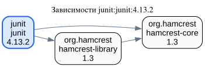
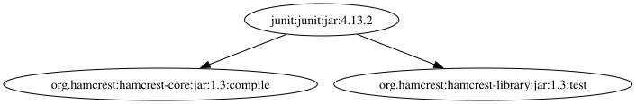
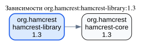
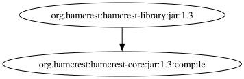
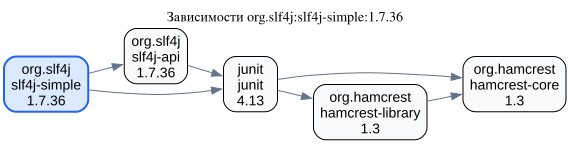
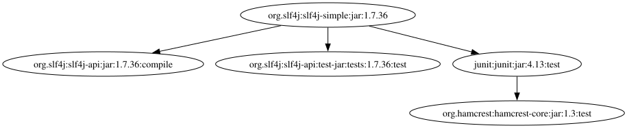

# Этап 5: сравнение со штатным инструментом Maven

Проверка выполнена 10 ноября 2026 года: Go 1.26.4, Graphviz 16.1.1,
Apache Maven 3.10.0, OpenJDK 27.0.1.0.3, Maven Dependency Plugin 3.8.1.
Все три запуска `dependency:tree` завершились `BUILD SUCCESS`.

## Как воспроизвести

```sh
make demo
make compare
```

Первый скрипт запускает нашу программу с тремя INI из `examples/stage5`,
показывает DOT в терминале и сохраняет DOT/SVG в `bin/stage5`.
Во всех трёх конфигурациях `filter` пуст, источник — Maven Central.

Второй скрипт скачивает опубликованный POM каждого **исходного пакета** и запускает
его как отдельный проект. Это позволяет сравнивать одинаковый корень, без добавления
искусственного проекта-обёртки. Для каждого POM выполняется команда:

```sh
mvn -B -ntp -f "$project_dir/pom.xml" \
    "-Dmaven.repo.local=$comparison_dir/cache" \
    org.apache.maven.plugins:maven-dependency-plugin:3.8.1:tree \
    -DoutputType=dot "-DoutputFile=$project_dir/maven.dot"
dot -Tsvg "$project_dir/maven.dot" -o "$project_dir/maven.svg"
```

Точные пути и команды заданы в [скрипте сравнения](../../scripts/compare_stage5.sh).
Maven используется только как эталон для требования пятого этапа: код Go получает
зависимости самостоятельно через HTTP и XML, не вызывает Maven и не читает его кэш.
Для сравнения не задаются `scope`, `includes`, `excludes` и `verbose`.
Следовательно, дерево Maven содержит зависимости самого корневого проекта всех scope,
а транзитивные зависимости выбираются по стандартным правилам Maven.

## Результаты

Вершина нашей программы — `groupId:artifactId:version` (GAV).
Maven различает также тип артефакта, classifier и scope. Для сопоставления
приводим его имена к GAV и объединяем совпавшие вершины и рёбра.
Корень включён в число вершин.

| Пакет | Наш граф: вершины / рёбра | Maven DOT: вершины / рёбра | Maven после приведения к GAV |
| --- | --- | --- | --- |
| `junit:junit:4.13.2` | 3 / 3 | 3 / 2 | 3 / 2 |
| `org.hamcrest:hamcrest-library:1.3` | 2 / 1 | 2 / 1 | 2 / 1 |
| `org.slf4j:slf4j-simple:1.7.36` | 5 / 6 | 5 / 4 | 4 / 3 |

### JUnit 4.13.2

[Наш DOT](graphs/junit.dot) · [Maven DOT](maven/junit.dot)





Набор GAV совпадает. В нашем графе дополнительно сохранено ребро
`hamcrest-library:1.3 -> hamcrest-core:1.3`.
У JUnit `hamcrest-core` уже является прямой зависимостью с `scope=compile`,
а `hamcrest-library` подключён с `scope=test`.
Стандартное дерево Maven без `verbose` оставляет выбранную прямую зависимость,
не дублируя путь к тому же артефакту через библиотеку.
Наш DFS сохраняет оба входящих ребра общей зависимости, хотя обходит её один раз.

### Hamcrest Library 1.3

[Наш DOT](graphs/hamcrest-library.dot) · [Maven DOT](maven/hamcrest-library.dot)





После приведения подписей к GAV результаты полностью совпадают:
одна связь `hamcrest-library:1.3 -> hamcrest-core:1.3` и две вершины.
Различаются только оформление и дополнительные поля подписи Maven.

### SLF4J Simple 1.7.36

[Наш DOT](graphs/slf4j-simple.dot) · [Maven DOT](maven/slf4j-simple.dot)





В Maven есть две отдельные вершины SLF4J API: обычный `jar` версии 1.7.36
со scope `compile` и `test-jar` с classifier `tests` и scope `test`.
Наша программа объединяет их в одну вершину `org.slf4j:slf4j-api:1.7.36`,
поскольку обе записи используют один POM.

После такого объединения наш граф дополнительно содержит:

- `slf4j-api:1.7.36 -> junit:4.13` — тестовая зависимость из родительского POM
  SLF4J; Maven не передаёт тестовые зависимости транзитивно.
- `junit:4.13 -> hamcrest-library:1.3` — собственная тестовая зависимость JUnit;
  Maven также не передаёт её в проект SLF4J Simple.
- `hamcrest-library:1.3 -> hamcrest-core:1.3` — продолжение предыдущей ветви,
  отсутствующей в стандартном дереве.

Сам JUnit присутствует в обоих результатах: для корневого проекта SLF4J Simple
он является унаследованной прямой тестовой зависимостью. Maven сохраняет и
транзитивную `hamcrest-core`, которая у JUnit имеет scope `compile`.
В приведённом к GAV дереве Maven нет рёбер, отсутствующих в нашем графе.

## Объяснение границ сравнения

Программа строит граф объявленных зависимостей базовых POM, включая `test`,
`provided` и `optional`, и сохраняет общие связи. Maven строит дерево разрешённых
зависимостей проекта с правилами scope, optional, exclusions и выбора версии.
Эти правила, активация профилей и различение type/classifier в нашей модели
не реализованы. Поэтому полученная диаграмма не является точной моделью classpath
сборки Maven; выявленные различия описаны явно, данные не подгонялись под эталон.

При запуске Maven сообщил предупреждения о старых настройках в опубликованных POM
JUnit (`prerequisites`) и SLF4J (`reportPlugins`). Они не помешали построению деревьев;
исходные POM при сравнении не редактировались.

Источники: [документация dependency:tree](https://maven.apache.org/plugins/maven-dependency-plugin/tree-mojo.html),
[правила scope и разрешения зависимостей Maven](https://maven.apache.org/guides/introduction/introduction-to-dependency-mechanism.html),
[POM JUnit](https://repo.maven.apache.org/maven2/junit/junit/4.13.2/junit-4.13.2.pom),
[POM Hamcrest Library](https://repo.maven.apache.org/maven2/org/hamcrest/hamcrest-library/1.3/hamcrest-library-1.3.pom),
[POM SLF4J Simple](https://repo.maven.apache.org/maven2/org/slf4j/slf4j-simple/1.7.36/slf4j-simple-1.7.36.pom),
[родительский POM SLF4J](https://repo.maven.apache.org/maven2/org/slf4j/slf4j-parent/1.7.36/slf4j-parent-1.7.36.pom).
